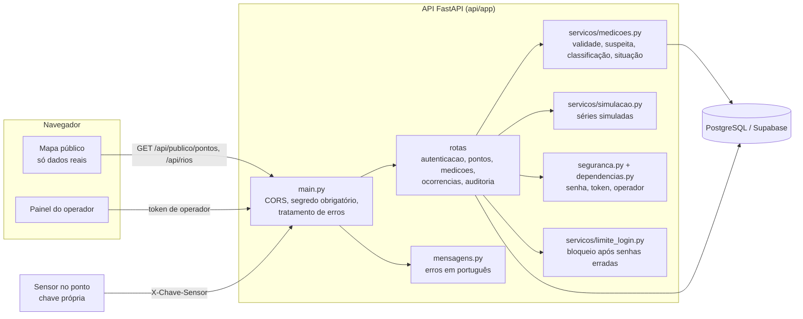
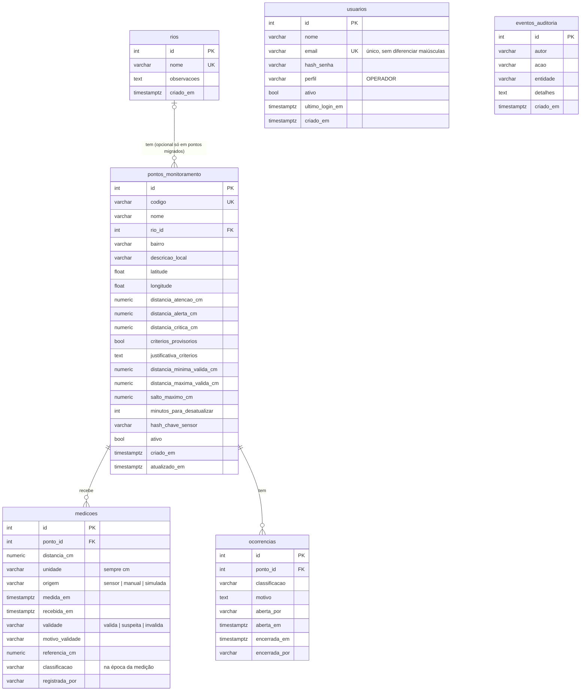
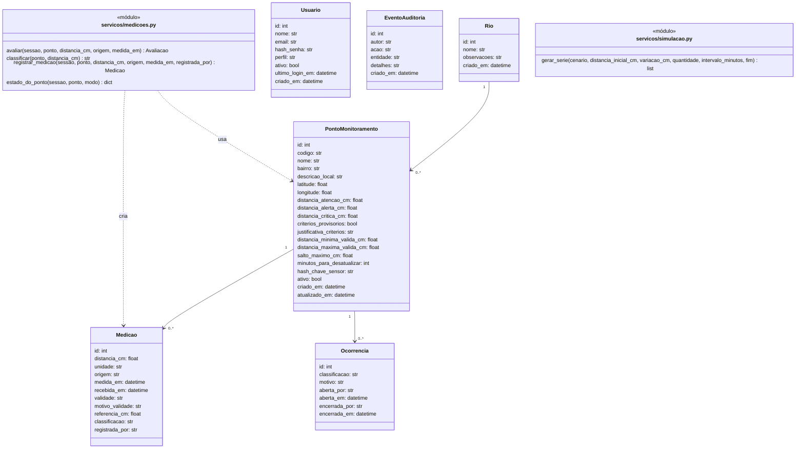
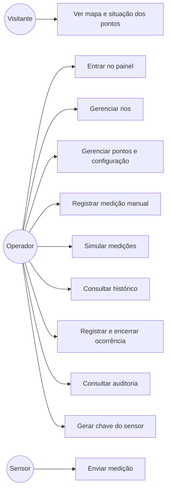
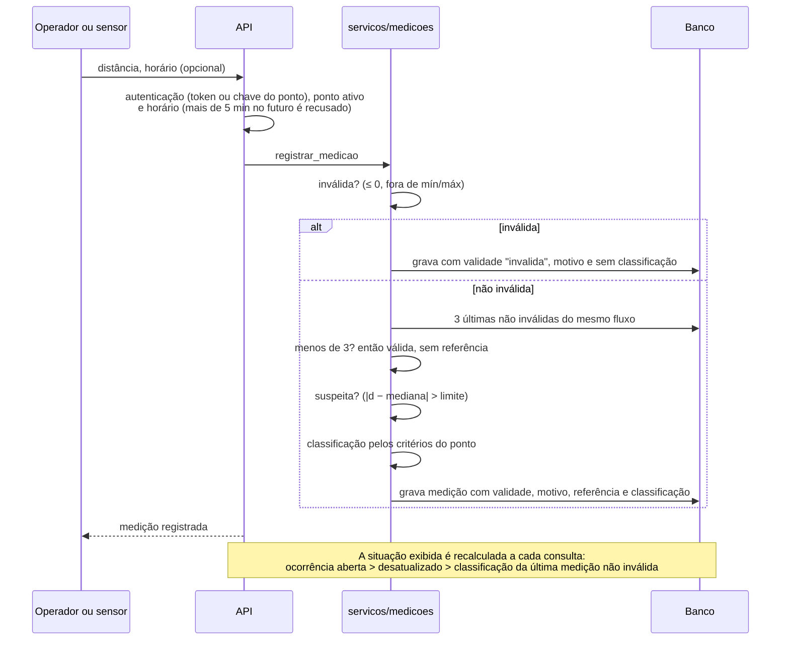

# Arquitetura e dados

Os diagramas deste arquivo estão em Mermaid, um formato de texto que o GitHub mostra como imagem. Eles são a fonte: qualquer mudança começa aqui. As versões em PNG, usadas nos documentos Word, ficam em `documentos/tecnico/diagramas/` e são geradas por `documentos/gerar_documentos.py` com o mesmo conteúdo; casos de uso, classes e modelo de dados são desenhados na notação UML, que o Mermaid não oferece ([D11](04-decisoes.md#d11)). Os diagramas da versão 1 (Astah e MER de junho de 2026) não fazem parte deste repositório.

## Componentes

O site é estático (HTML, CSS e JS, sem etapa de compilação). Toda regra de validação e de classificação fica na API, em `servicos/medicoes.py`. O site só exibe o que a API calcula, então não existe uma segunda cópia da regra que possa ficar diferente.

### Organização do site

| Pasta / arquivo | Papel |
|---|---|
| `css/variaveis.css` | Variáveis de design (cores, tipografia, espaçamento, raios, sombras, movimento) para os temas claro e escuro, no estilo Fluent 2 |
| `css/base.css`, `componentes.css`, `estrutura.css`, `paginas.css`, `responsivo.css` | Base e foco visível; componentes (botão, campo, cartão, selo, tabela, diálogo, aviso, estados); estrutura; páginas; pontos de quebra (1200, 1024, 768 e 560 px) |
| `js/interface.js` | Componentes de interface: diálogo acessível (foco preso, Esc, não fecha formulário ao clicar fora), confirmação, aviso, botão ocupado, estados de carregando/vazio/erro, campos com erro |
| `js/tema.js` | Tema claro/escuro: segue o sistema na primeira visita e guarda a escolha |
| `js/icones.js` | Ícones de contorno em SVG, todos no mesmo traço |
| `js/principal.js`, `configuracao.js` | Ponto de partida: liga as telas aos botões; endereço da API (local ou publicado) |
| `js/api.js`, `dados.js`, `formatacao.js`, `estado.js` | Acesso à API, lista dos pontos carregados, formatação e estado da tela |
| `js/mapa.js`, `painel.js`, `pontos.js`, `medicoes.js`, `simulacao.js`, `ocorrencias.js`, `auditoria.js`, `autenticacao.js`, `navegacao.js` | Uma tela ou função por arquivo |

## Modelo de dados

Restrições no banco (criadas nas migrações 002 e 004, com os nomes atuais dados pela 006):

- código do ponto e nome do rio únicos;
- critérios todos vazios ou atenção > alerta > crítico > 0;
- mínima < máxima;
- `origem`, `validade`, `unidade` e `classificacao` só aceitam os valores listados;
- no máximo uma ocorrência aberta por ponto (índice único parcial);
- índice em `(ponto_id, medida_em)` para o histórico.
- e-mail do operador único, sem diferenciar maiúsculas, e no máximo um operador ativo (migração 002).

### Por que estas tabelas

| Tabela | Por que existe | O que ficou de fora e por quê |
|---|---|---|
| `rios` | A visão fala em pontos "em um ou mais rios". Uma tabela evita nomes digitados de jeitos diferentes e permite filtrar o mapa por rio. | Nada. |
| `pontos_monitoramento` | Ponto físico **e** o seu sensor, juntos (decisão D3). Guarda os critérios (RF03) e os parâmetros de validação (RF04). | Tabelas separadas de Sensor e Limiar: nenhum requisito atual pede vários sensores por ponto nem histórico de limiares fora da auditoria. |
| `medicoes` | Histórico com valor, unidade, horário, origem e o resultado da validação, para explicar por que cada leitura foi aceita ou não. | Nível absoluto: sem referência de instalação, não seria um dado observado (RN01). |
| `ocorrencias` | Observação de campo do operador que prevalece sobre as medições (RF10). | Nada. |
| `usuarios` | Login do operador. | Moradores: saíram do escopo (sem notificações, não haveria finalidade para guardar dados pessoais). |
| `eventos_auditoria` | Rastreabilidade (RF11). | Nada. |

Entidades do MER de junho de 2026 que não entraram:

- `EstadoPonto`, `Alerta` e `EventoDeRisco`: a situação é calculada da última medição; não há alertas com ciclo de vida.
- `ConfirmacaoAlagamento`, `Endereco`, `ConsentimentoLGPD`, `PedidoEmergencial`, `Morador` e `Abrigo`: funcionalidades que saíram do escopo.

### Tabelas antigas

`sensores`, `leituras_sensores`, `moradores`, `abrigos` e `ocorrencias_manuais` foram usadas pelo MVP de 2026.1 (com os nomes em inglês `sensors`, `sensor_readings`, `residents`, `shelters` e `manual_occurrences`) e **não são mais lidas pela aplicação**. A migração 004:

- copiou os sensores como pontos, sem rio e sem critérios, porque os limiares antigos eram de **nível** e não valem para distância;
- copiou as ocorrências manuais;
- não converteu as leituras antigas, que eram de nível.

As tabelas antigas continuam no banco com os mesmos dados; a migração 006 só trocou os nomes delas e das colunas para português. A tabela `moradores` tem dados pessoais. Depois de conferir que nada mais é necessário, o responsável pelo banco deve apagá-la (`drop table moradores;`), já que não há mais finalidade para esses dados. Essa remoção é manual e não está em nenhuma migração, de propósito.

## Classes principais

As classes de dados (`app/modelos.py`) são tabelas do SQLAlchemy. As colunas de chave estrangeira (`rio_id`, `ponto_id`) não aparecem como atributos, porque na UML a ligação entre as classes já é mostrada pelas associações (as linhas com 1 e 0..*). As regras não ficam em classes: ficam em funções dos módulos `servicos/medicoes.py` e `servicos/simulacao.py`, que o diagrama mostra com o estereótipo «módulo». `gerar_serie` só calcula os valores da série; a rota de simulação (`rotas/medicoes.py`) grava cada valor com a mesma `registrar_medicao` usada pelas medições reais, então as simuladas recebem a mesma validação. `Usuario` e `EventoAuditoria` não têm relação com as outras tabelas: a auditoria guarda o e-mail de quem agiu como texto.

## Casos de uso

## Fluxo de uma medição

## Nomes em português e nomes padrão das ferramentas

Tabelas, colunas, modelos, rotas e campos do JSON da API estão em português, com os mesmos termos usados nos requisitos (ponto, medição, ocorrência, validade, situação). Por isso não é preciso uma tabela de tradução entre o documento e o código. O que é convenção de ferramenta ficou com o nome padrão: variáveis de ambiente (`DATABASE_URL`, `JWT_SECRET_KEY`, `APP_ENV`, `CORS_ORIGINS`), a estrutura `app/main.py` do FastAPI e as pastas `tests/` e `migrations/`. A lista completa está na decisão [D22](04-decisoes.md#d22).

Valores que o sistema grava e exibe:

| Campo | Valores |
|---|---|
| `origem` (medição) | `sensor`, `manual`, `simulada` |
| `validade` (medição) | `valida`, `suspeita`, `invalida` |
| `situacao` (ponto) | `verde`, `amarelo`, `laranja`, `vermelho`, `sem_criterio`, `sem_dados`, `desatualizado` |
| `perfil` (usuário) | `OPERADOR` |

## API

| Método e rota | Acesso | Uso |
|---|---|---|
| `GET /api/saude` | público | Verifica a API e o banco |
| `POST /api/autenticacao/login` | público | Login (bloqueia por 15 min depois de 5 senhas erradas) |
| `GET /api/autenticacao/operador` | operador | Dados do operador logado |
| `GET /api/publico/pontos` | público | Pontos ativos com situação real |
| `GET /api/rios` | público | Rios e número de pontos |
| `POST /api/rios`, `PUT /api/rios/{id}`, `DELETE /api/rios/{id}` | operador | Rios (excluir só se não houver pontos ligados) |
| `GET/POST /api/pontos`, `GET/PUT/DELETE /api/pontos/{id}` | operador | Pontos (DELETE desativa) |
| `DELETE /api/pontos/{id}/definitivo` | operador | Exclui de vez um ponto sem medição real e sem ocorrência |
| `POST /api/pontos/{id}/chave-sensor` | operador | Gera ou troca a chave do sensor |
| `GET /api/pontos/{id}/medicoes?modo=real\|simulada\|todas&desde=&ate=&limite=` | operador | Histórico |
| `POST /api/pontos/{id}/medicoes` | operador | Medição manual ou simulada avulsa |
| `POST /api/pontos/{id}/simulacoes` | operador | Série simulada |
| `DELETE /api/pontos/{id}/medicoes/simuladas` | operador | Apaga só as simuladas |
| `POST /api/sensor/medicoes` | chave do ponto (cabeçalho `X-Chave-Sensor`) | Medição de sensor |
| `GET /api/ocorrencias?situacao=abertas\|todas`, `POST /api/pontos/{id}/ocorrencias`, `PUT /api/ocorrencias/{id}/encerrar` | operador | Ocorrências |
| `GET /api/auditoria` | operador | Auditoria |

Os erros vêm no formato `{"detalhe": "texto"}` ou, quando há campo inválido, `{"detalhe": [{"campo": "...", "mensagem": "..."}]}`.

## Migrações

| Arquivo | Conteúdo |
|---|---|
| `001_esquema_base.sql` | Tabelas do MVP de 2026.1, reconstruídas a partir dos modelos SQLAlchemy antigos. Usa `if not exists`. |
| `002_autenticacao_operador.sql` | Tabela de usuários e a regra de um operador ativo (original, sem mudança). |
| `003_limiares_positivos_sensores.sql` | Restrição dos limiares antigos (original, sem mudança). |
| `004_monitoramento_por_distancia.sql` | Modelo 2.0 e cópia dos dados aproveitáveis. Reversão em `reverter/004_reverter.sql`. |
| `005_seguranca_por_linha.sql` | Liga a RLS em todas as tabelas (a API é dona das tabelas e não é afetada). Reversão em `reverter/005_reverter.sql`. |
| `006_nomes_em_portugues.sql` | Renomeia tabelas, colunas, restrições, índices e sequências para português, sem apagar dados, e troca o perfil `OPERATOR` por `OPERADOR`. Reversão em `reverter/006_reverter.sql`. |

As migrações 001 a 005 ficaram com o conteúdo original, com os nomes em inglês da época, porque são o registro do que já foi executado no Supabase; só os nomes dos arquivos mudaram. Por isso, o modelo de dados acima vale depois da 006.

`scripts/migrar.py` aplica as pendentes e registra cada uma na tabela `migracoes_aplicadas`. Num banco que já tinha as migrações antigas (registradas em `schema_migrations`, com os nomes de arquivo em inglês), o script renomeia esse registro e reconhece os nomes antigos, então nada é aplicado duas vezes.
