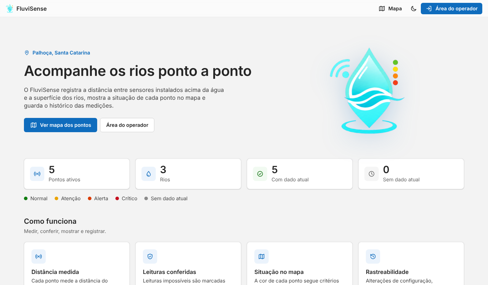
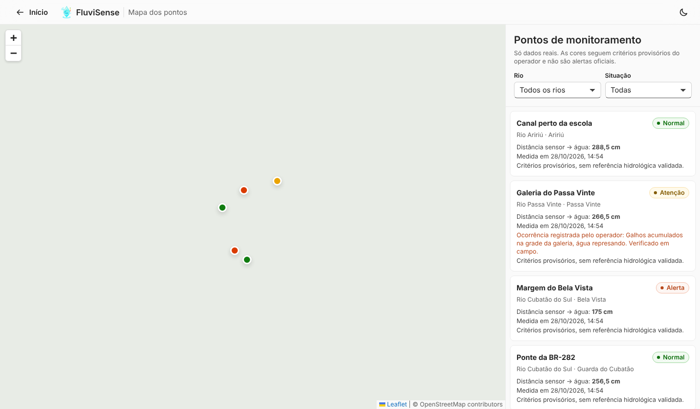
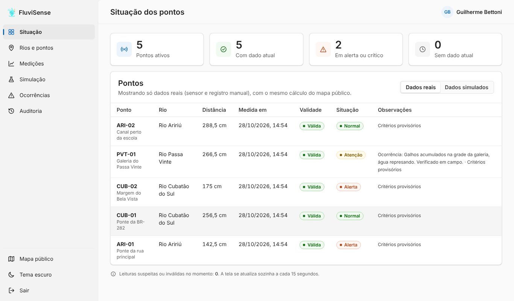
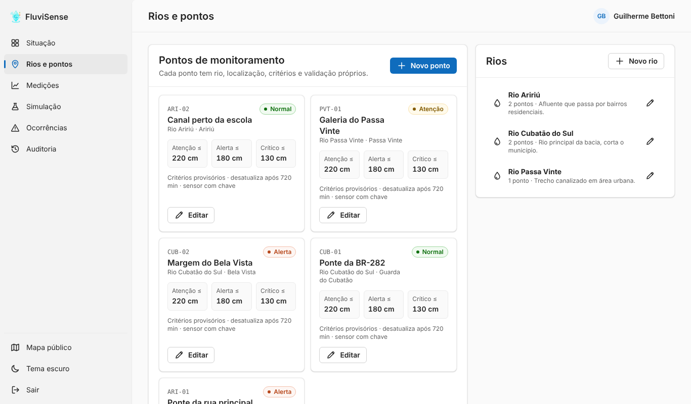
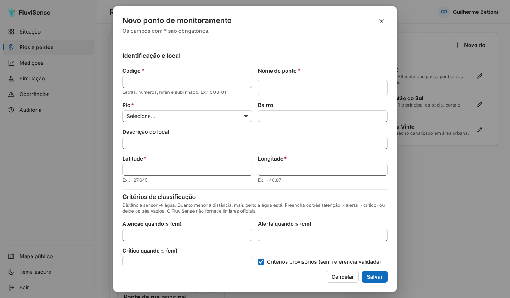
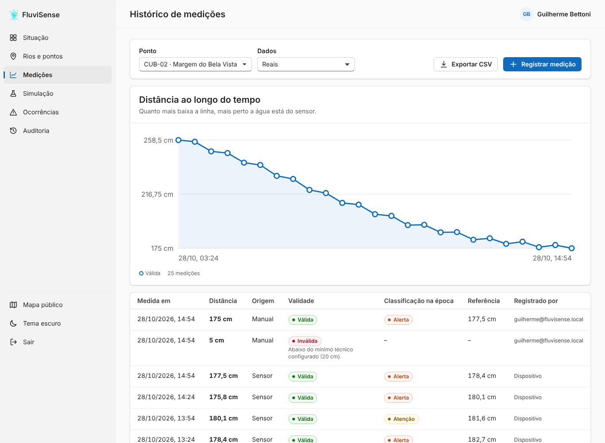
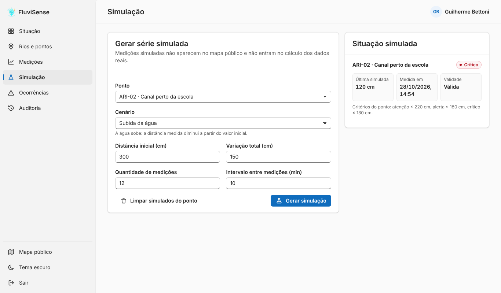
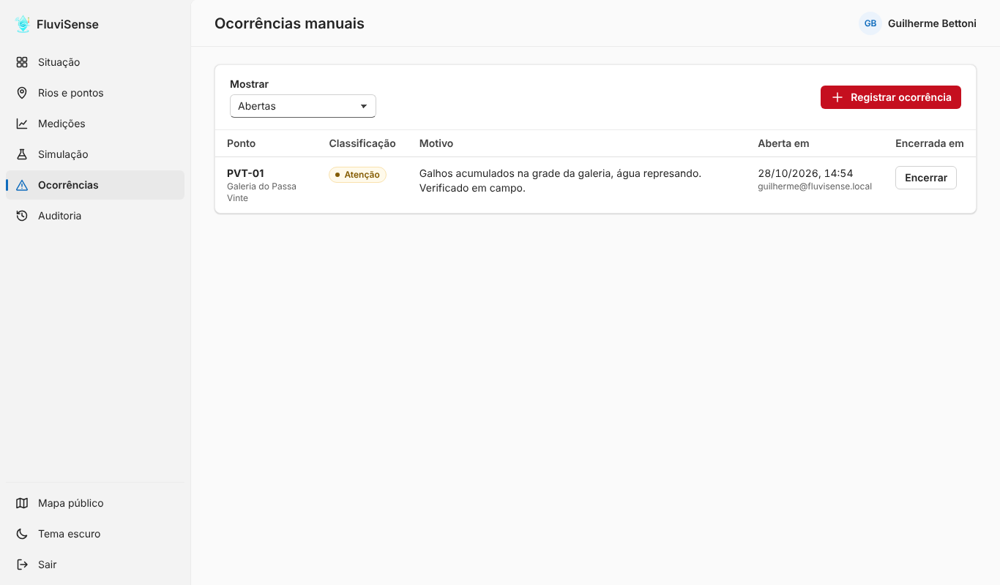
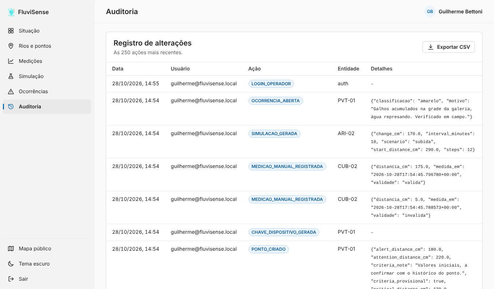

# Validação

Resultados reais das execuções de 21/10/2026 a 28/10/2026, num ambiente Linux com Python 3.13 e PostgreSQL 16 local. Em 28/10/2026, os testes com SQLite também passaram com Python 3.11 e 3.12. Os números abaixo são da última execução, em 28/10/2026, já com os nomes em português no banco e na API, e com os nomes padrão das ferramentas mantidos (decisão [D22](04-decisoes.md#d22)). Os mesmos testes podem ser repetidos seguindo o [README](../../README.md#testes).

## Testes automatizados da API (`api/tests`)

| Execução | Resultado |
|---|---|
| `pytest` (SQLite temporário), em Python 3.11, 3.12 e 3.13 | **66 aprovados, 3 ignorados** em cada versão. Os ignorados são os dois testes de migrações e o teste de RLS, que só rodam em PostgreSQL. |
| `TEST_DATABASE_URL=postgresql://... pytest` (PostgreSQL 16, banco criado pelas migrações 001 a 006) | **69 aprovados** |

O que os testes cobrem:

| Arquivo | Assunto |
|---|---|
| `test_autenticacao.py` | Login; 17 rotas administrativas recusadas sem token; token inválido e token de outro papel; rotas públicas |
| `test_pontos.py` | Vários pontos com configuração própria; código duplicado; rio inexistente; critérios incompletos ou fora de ordem; auditoria com antes e depois; desativação que mantém o histórico; rios; API pública sem dados internos |
| `test_medicoes.py` | Valor, unidade, horário, ponto e origem; histórico ordenado e filtrado; horário no futuro; leituras inválidas guardadas sem mudar a situação; salto brusco suspeito e exibido; mudança sustentada confirmada sem travar; pico isolado; limite de salto por ponto; classificação por distância; ponto sem critério |
| `test_simulacao_e_situacao.py` | Subida, descida e oscilação; simulação inválida; simulado não contamina real nem mapa; limpeza só das simuladas; dado desatualizado; ponto sem medição; ocorrência manual |
| `test_exclusoes.py` | Exclusão de rio vazio; rio com ponto (até desativado) recusado; rio liberado após mover o ponto; exclusão de ponto só com dados simulados (que saem junto e liberam o código); ponto com medição real ou ocorrência recusado; exclusão sem login e de ponto inexistente |
| `test_sensor_e_auditoria.py` | Chave do sensor (sem chave, chave errada, chave de outro ponto, chave trocada); auditoria sem segredos |
| `test_seguranca.py` | Bloqueio do login depois de 5 senhas erradas (HTTP 429), desbloqueio depois do prazo, acerto zera a contagem, recusa de segredo JWT curto, RLS ligada em todas as tabelas (só PostgreSQL) |
| `test_mensagens.py` | Erros de validação e de rota inexistente saem em português; as mensagens das regras do projeto continuam iguais |
| `test_migracoes.py` | Toda coluna usada pelos modelos (`app/modelos.py`) existe no banco criado pelas migrações; depois da 006, nenhuma tabela, coluna, restrição ou índice ficou com nome em inglês |

## Migrações

Verificado em PostgreSQL 16 local:

1. **Banco vazio:** `migrar.py` aplicou 001 a 006; uma segunda execução respondeu "Nenhuma migração pendente".
2. **Banco no formato do MVP antigo** (tabelas criadas pelos modelos de 2026.1, com um sensor, uma leitura, uma ocorrência encerrada, um morador e um abrigo):
   - a 004 criou as tabelas novas;
   - copiou o sensor como ponto (sem rio e sem critérios) e copiou a ocorrência;
   - **não alterou** as tabelas antigas: leitura e morador continuaram lá.
3. **Reversão:** `reverter/004_reverter.sql` removeu só as tabelas novas. Reaplicar a 004 depois disso recriou tudo e copiou os dados de novo.
4. **Criação do operador:** `criar_operador.py` criou o operador e **recusou** criar um segundo operador ativo.

5. **Troca dos nomes para português (006) num banco com dados.** Partindo de uma cópia de um banco já no estado da 005, com dados de demonstração (5 rios, 7 pontos, 150 medições, 2 ocorrências e 36 registros de auditoria):
   - `migrar.py` reconheceu o registro antigo (`schema_migrations`, com os nomes de arquivo em inglês) e aplicou só a 006;
   - depois da 006, as quantidades continuaram as mesmas, e a soma das 150 distâncias também (34.969,90 cm antes e depois), o que mostra que nenhum valor foi alterado;
   - o perfil do operador passou de `OPERATOR` para `OPERADOR`, e o login continuou funcionando;
   - `reverter/006_reverter.sql` devolveu os nomes em inglês, e rodar `migrar.py` de novo reaplicou a 006.

**Não verificado:** a aplicação das migrações no banco real do Supabase, porque não há acesso a ele neste ambiente. O esquema real também não pôde ser conferido; a 001 foi reconstruída a partir dos modelos antigos. Antes de rodar em produção, faça o backup indicado no README.

## Segurança, conferida com a API ligada

- Sem `JWT_SECRET_KEY` (ou com menos de 32 caracteres), a API não liga e mostra como gerar um segredo.
- Seis tentativas de login com senha errada: as cinco primeiras responderam 401 e a sexta respondeu 429, com a mensagem "Tente de novo em 15 minutos".
- Com a RLS ligada (migração 005), um usuário do banco que não é dono das tabelas leu 0 linhas; o dono (usado pela API) continuou lendo normalmente.
- O Leaflet é carregado com verificação de integridade (SRI): se o arquivo da CDN for alterado, o navegador não o executa.

## Teste de fumaça da interface (`site/tests/test_interface.py`)

Primeira execução em 23/10/2026, depois da revisão visual (Fluent). Rodou no Chromium (Playwright), com a API local na porta 8001 e o site na porta 8080, sobre um banco recém-migrado. **32 verificações aprovadas, sem nenhum erro de JavaScript no console.** Repetido em 27/10/2026, depois da reorganização das pastas, e em 28/10/2026, já com o nome FluviSense: 32 verificações aprovadas em duas execuções seguidas no mesmo banco (o teste usa nomes únicos a cada execução). Na revisão de 28/10/2026, uma execução interrompida no meio deixou uma ocorrência aberta e a seguinte falhou, porque o teste esperava a lista de ocorrências vazia; o teste passou a encerrar só a ocorrência que ele mesmo criou e voltou a passar com essa ocorrência antiga ainda aberta. Depois da troca dos nomes para português (D22), o teste foi refeito com os novos identificadores da tela e rodou num banco novo criado pelas migrações 001 a 006: 32 verificações aprovadas em duas execuções seguidas, sem erro de JavaScript.

O teste cobre:

- **Tema:**
  - a primeira visita segue o tema do sistema;
  - a escolha manual continua depois de recarregar;
  - o tema escuro é aplicado em todas as abas do painel, no diálogo e no mapa.
- **Login:**
  - erro em cada campo vazio, com foco no primeiro;
  - senha errada mostra mensagem dentro do formulário.
- **Diálogos:**
  - clicar fora de um formulário **não** fecha o diálogo nem apaga o que foi digitado;
  - Esc pede confirmação antes de descartar;
  - o foco do teclado fica preso dentro do diálogo;
  - o botão Cancelar fecha.
- **Exclusão:**
  - cancelar mantém o diálogo aberto;
  - rio vazio é excluído e some da lista;
  - rio com ponto ligado e ponto com medição real são recusados com mensagem explicativa;
  - ponto sem histórico real é excluído.
  Depois do teste, conferi no banco que as exclusões foram gravadas, que os dados recusados continuaram lá e que a auditoria registrou `RIO_EXCLUIDO` e `PONTO_EXCLUIDO`.
- **Validação nos campos:** critério incompleto e simulação impossível são barrados antes de chegar à API.
- **Fluxos principais:**
  - cadastro de rios e pontos;
  - edição de ponto;
  - confirmação de desativação dentro do próprio diálogo (cancelar mantém o formulário);
  - medições manuais com leitura suspeita;
  - gráfico;
  - simulação;
  - painel real × simulado;
  - ocorrência aberta e encerrada com confirmação;
  - auditoria;
  - mapa só com dados reais e filtro por rio;
  - saída da sessão.
- **Celular (390 px), nos dois temas:**
  - sem rolagem horizontal em início, login, mapa, medições e diálogo;
  - navegação em gaveta;
  - diálogo como painel inferior.

## Acessibilidade automática (axe-core 4.10, regras WCAG 2.0/2.1 A e AA)

Analisadas nos temas claro e escuro: início, mapa, as 6 abas do painel e o diálogo de ponto. **Nenhuma violação encontrada**, incluindo contraste de cores. Repetida em 28/10/2026, depois da troca dos nomes para português, a análise apontou uma falha no mapa: quando a biblioteca do mapa não carrega, os botões da lista de pontos ficam desativados e a lista, que tem rolagem, não podia ser alcançada pelo teclado (regra `scrollable-region-focusable`). A lista passou a receber foco (`tabindex="0"` em `#mapa-pontos`, no `site/index.html`) e a análise seguinte não encontrou nenhuma violação. A ferramenta automática não substitui o teste com leitor de tela, que não foi feito.

**Limitação do ambiente:** o acesso externo bloqueou Leaflet, OpenStreetMap e VLibras. Por isso, no teste de fumaça, o mapa apareceu com o aviso "Mapa indisponível", e o teste conferiu a lista de pontos. Para as capturas de tela (seção abaixo), o Leaflet foi carregado a partir de uma cópia local da mesma versão (1.9.4): os marcadores apareceram nas posições e cores certas. O fundo do OpenStreetMap e o mapa escurecido no tema escuro **não foram verificados** aqui e precisam ser conferidos num navegador comum.

## Capturas de tela

Feitas em 28/10/2026 no Chromium (1366 × 800 px, tema claro), com a API e o site rodando como descrito no README. Os dados são **de demonstração**, cadastrados pela própria API só para mostrar a interface: três rios de Palhoça, cinco pontos com coordenadas aproximadas e leituras enviadas pela rota do sensor. Não são leituras reais desses rios. O fundo do mapa (OpenStreetMap) não carregou no ambiente da captura; os marcadores aparecem nas posições certas.

## O que ainda não foi validado

- Envio por um ESP32 real: a rota foi testada só com chamadas da API.
- Desempenho com muitos pontos e muitas medições.
- Critérios de classificação com referência hidrológica: os pontos usam critérios provisórios definidos pelo operador.
- A RLS no banco real do Supabase: foi verificada só no PostgreSQL local.
- Publicação no Render com as variáveis de produção.
